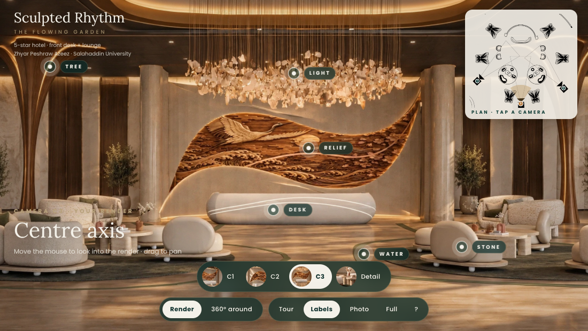
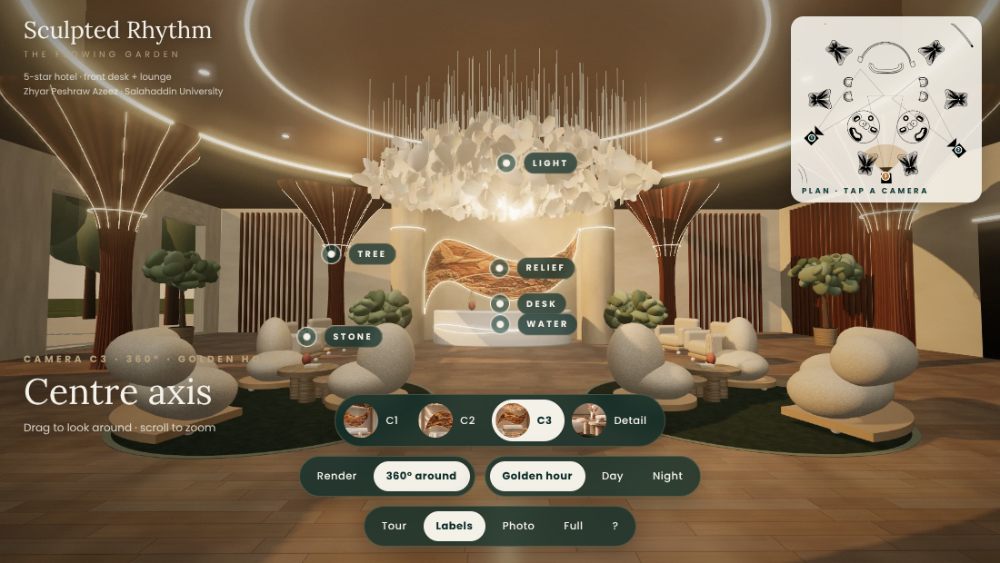

# Sculpted Rhythm — The Flowing Garden
### Inside the reception · interactive 3D viewer

A 5-star hotel front desk and lounge, designed around three ideas: **Tree**, **Water** and **Stone**.
*Growth. Flow. Gathering.*

**Author:** Zhyar Peshraw Azeez — Department of Architecture, Salahaddin University

## What it is
A single-page viewer that puts you inside the design:

- **Render mode** — the project's own renders (cameras C1, C2, C3 and a stone detail shot) with an estimated depth map, so the room shifts in 3D as you move the mouse or tilt your phone.
- **360° mode** — stand at each camera point and look in every direction (built from the 3D model, in Golden hour / Day / Night light).
- Labelled hotspots for Tree, Water, Stone, Relief, Light and Desk, a plan mini-map, a tour mode, and photo export.

## Run it
**Online (GitHub Pages):** *Settings → Pages → Deploy from a branch → `main` / root.* The site will be at `https://<your-username>.github.io/<repo-name>/`.

**Offline:** download the repo and double-click `index.html`. No server, install or internet connection is needed — everything (images, fonts, code) is inside that one file.

## Controls
| | |
|---|---|
| Look into the render | move the mouse / tilt phone |
| Pan / zoom | drag / scroll or pinch |
| Switch view | C1 · C2 · C3 · Detail, or tap a camera on the plan |
| Tour | plays all renders in sequence |
| Keys | `1`–`4` view · `T` tour · `L` labels · `P` photo · `F` fullscreen · `H` help |

Works in current Chrome, Edge, Firefox and Safari (WebGL 2).

## Files
- `index.html` — the complete viewer
- `board/Sculpted_Rhythm_Board.pdf` — the presentation board
- `previews/` — screenshots

## Copyright
© Zhyar Peshraw Azeez. All rights reserved. Images and design are the author's academic work; please ask before reusing them.
